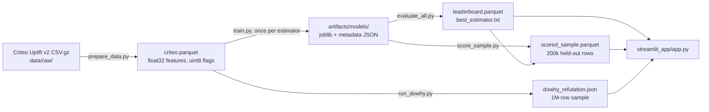

# UpliftBench

Five uplift estimators (S-, T-, and X-learner, DR-learner, LinearDML) benchmarked on the 13.98M-row Criteo Uplift v2 randomized experiment. Qini and AUUC are written from scratch, DoWhy refuters stress-test the average effect, and a Streamlit budget explorer reads precomputed scores instead of loading a model.

[](https://github.com/TirtheshJani/UpliftBench/actions/workflows/ci.yml)
[](pyproject.toml)
[](LICENSE)

A response model predicts who will convert. An uplift model predicts who will convert because they were treated. No row is ever observed both treated and untreated, so there is no per-row label to check it against.

UpliftBench is a Python library with Typer CLIs that takes the public Criteo Uplift Prediction Dataset v2 from raw CSV to a typed parquet file, fits five conditional average treatment effect (CATE) estimators on LightGBM, and ranks them with population-level uplift metrics. It then stress-tests the average effect with DoWhy's four refuters and turns predictions into a four-way targeting segmentation.

The code, tests, and CI are in place. Full-data benchmark numbers are not committed yet, so the leaderboard has to be reproduced locally (see [Results](#results)).

## Highlights

- Five estimators behind one `BaseUpliftEstimator` protocol (`fit`, `predict_cate`, `predict_baseline`) and a name registry, so the train CLI, leaderboard builder, and scorer handle every model the same way. The S, T, and X learners are written directly on LightGBM; the DR-learner and LinearDML wrap EconML with LightGBM nuisance models and 3-fold cross-fitting.
- Qini coefficient, AUUC, and top-k uplift implemented in numpy ([`src/upliftbench/eval/`](src/upliftbench/eval/)) and tested on synthetic data with a known per-row uplift: a ranker sorted on the true signal must score above 0.05, and the mean of eight random rankers must land within 0.03 of zero.
- DoWhy model, identify, estimate, refute pipeline with all four standard refuters (placebo treatment, random common cause, data subset, unobserved common cause) on a 1M-row sample that preserves the treatment ratio. A refuter that throws is recorded in the output JSON instead of killing the run.
- A data path designed for a 16 GB laptop, CPU only: streaming CSV.gz to zstd parquet with an explicit float32/uint8 schema, column-pruned reads, and LightGBM with `max_bin=63`.
- Every saved model gets a sibling JSON with git SHA, library versions, fit time, process RSS after fitting, metrics, and a 16-character SHA-256 prefix of the held-out row indices. One seed (`SEED = 42`) drives the train/test split, the DoWhy subsample, and the scoring sample.
- GitHub Actions ([`ci.yml`](.github/workflows/ci.yml)) runs ruff, a ruff format check, mypy, pytest with coverage, and an em-dash check on pushes to `main` and `claude/**` branches and on pull requests to `main`. `make ci` runs the same steps locally, with one shell caveat noted under [Getting started](#getting-started).

## Results

No benchmark results are published in this repository yet. The leaderboard (`artifacts/leaderboard.parquet`), the scored sample, and the DoWhy refutation JSON are produced locally by `make eval`, `make score`, and `make dowhy`, and none of them are committed. The notebooks in [`notebooks/`](notebooks/) are saved without outputs. `.gitattributes` already routes the three artifacts through Git LFS for when they are published.

## How it works



The library in `src/upliftbench/` holds the logic, and the scripts, app, and analysis notebooks import it. `notebooks/kaggle_end_to_end.ipynb` is the exception: a self-contained copy that trains all five estimators on a 2M-row subsample, meant to stay under Kaggle's 9-hour CPU limit. The outcome is `visit`, the treatment is `treatment`, and the features are the twelve anonymized columns `f0` to `f11`.

### Estimators

| `--estimator` key | Method | Implementation |
|---|---|---|
| `s-learner` | One model with treatment as a feature; CATE = mu(x, 1) - mu(x, 0) | LightGBM booster, written here |
| `t-learner` | One model per arm; CATE = mu1(x) - mu0(x) | LightGBM, written here |
| `x-learner` | Imputes per-row effects using the opposite arm's model, fits one effect regressor per arm, then blends them with the empirical treatment rate as the propensity | LightGBM, written here (Kunzel et al., 2019) |
| `dr-learner` | Builds pseudo-outcomes from a propensity model and an outcome model (consistent if either one is correctly specified), 3-fold cross-fitting | EconML `DRLearner` |
| `dml` | Residualizes outcome and treatment on the features, then fits a linear final stage | EconML `LinearDML`, `cv=3` |

All five share one LightGBM parameter dict in [`config.py`](src/upliftbench/config.py) (200 trees, 63 leaves, learning rate 0.05) so the comparison is not confounded by per-model tuning. For the EconML estimators, `predict_baseline` comes from a separate LightGBM classifier fit on control rows, which the segmentation step needs. Theory and implementation notes are in [`docs/ESTIMATORS.md`](docs/ESTIMATORS.md).

### Evaluation

Rows are sorted by predicted CATE. For the top `k` rows, with `N_t`, `N_c` the treated and control counts and `Y_t`, `Y_c` their positive outcomes:

```
Q(k)      = Y_t(k) - Y_c(k) * N_t(k) / N_c(k)
qini_coef = 2 * (area_under_Q - Q(N) / 2) / |Q(N)|
```

A random ranking scores near 0 and a better-than-random ranking scores positive. AUUC uses the rate difference `(Y_t/N_t - Y_c/N_c) * k` with the same normalization, and top-k uplift is the treated-minus-control outcome rate inside the top 10, 20, and 30 percent. `evaluate_estimator` in [`eval/harness.py`](src/upliftbench/eval/harness.py) returns all of these plus the curve points. Derivations are in [`docs/EVALUATION.md`](docs/EVALUATION.md).

### Segmentation and budget allocation

[`segmentation.py`](src/upliftbench/segmentation.py) labels each row from its predicted CATE and predicted baseline (control-arm) response, using the thresholds in `config.py`:

| Segment | `pred_cate` | `pred_baseline` |
|---|---|---|
| `persuadable` | > 0 | < 0.5 |
| `sure_thing` | <= 0 | >= 0.5 |
| `lost_cause` | <= 0 | < 0.5 |
| `do_not_disturb` | > 0 | >= 0.5 |

`budget_allocation` takes the top `budget_pct` of rows by predicted CATE and reports the segment mix of the people you would treat. The Streamlit app puts that behind a slider, with a per-estimator selector, the leaderboard, and the refutation table.

### Refutation

[`refute/dowhy_pipeline.py`](src/upliftbench/refute/dowhy_pipeline.py) builds a DoWhy `CausalModel` with the twelve features as common causes, identifies a backdoor estimand, estimates the average treatment effect on `visit` with `backdoor.linear_regression`, and runs the four refuters. This checks the population-level effect; it uses DoWhy's own estimator rather than the trained learners, which are compared separately on the leaderboard. The 1M-row default (`--sample`) keeps the refuters' repeated re-estimation within laptop wall time. See [`docs/REFUTATION.md`](docs/REFUTATION.md).

## Design decisions and lessons

Uplift has no ground-truth column, so every metric here scores a ranking against held-out treated and control outcomes. I divide the Qini area by `|Q(N)|` instead of by the optimal-minus-random area, because the "optimal" curve is poorly defined for binary outcomes with heterogeneous effects. The synthetic-data tests in `tests/eval/` pin that behavior so a refactor cannot flip its sign unnoticed.

The train/test split (`train_test_split_rct`) is a plain seeded permutation. It does not stratify on treatment, which keeps the randomized assignment untouched; the treatment ratio is about 0.85 ([`docs/DATA.md`](docs/DATA.md)). Randomization also lets the X-learner use the constant empirical treatment rate as its propensity instead of fitting one.

Three dependency problems shaped the code. DoWhy 0.12 still calls `networkx.algorithms.d_separated`, so `pyproject.toml` pins `networkx<3.3`. CausalML's X-learner path ran into a pygam and scipy conflict, so I wrote the X-learner directly on LightGBM. CausalML is still a declared dependency, but no estimator uses it, and `persistence.py` only records its version. Finally, `np.trapz` is gone in numpy 2.4 and `np.trapezoid` does not exist before 2.0, so the area integrals use a small trapezoid helper that works across `numpy>=1.26`.

The app never loads a model. `score_sample.py` precomputes CATE for every estimator on 200k held-out rows, and [`streamlit_app/app.py`](streamlit_app/app.py) imports only pandas, matplotlib, streamlit, `upliftbench.config`, and `upliftbench.segmentation`. The `streamlit` extra in `pyproject.toml` lists only the app's own dependencies (no LightGBM, EconML, DoWhy, or CausalML), aimed at Streamlit Community Cloud's 1 GB memory limit. Extras install on top of the base dependencies, though, so installing the package with that extra still pulls the full modeling stack. A slim install path is not wired up yet.

I also audited the repo for reproducibility gaps ([`docs/PHASE6_REPRO_AUDIT.md`](docs/PHASE6_REPRO_AUDIT.md)) and fixed the documentation drift and numpy breakage it found in follow-up commits.

## Tech stack

| Area | Tools |
|---|---|
| Modeling | LightGBM, EconML, DoWhy |
| Data and persistence | pyarrow, pandas, numpy, joblib |
| CLI and app | Typer, Streamlit, matplotlib |
| Tooling | uv (`uv.lock`), Make, pytest, ruff, mypy, pre-commit, GitHub Actions |

## Getting started

You need Python 3.11 or newer (CI runs 3.11), [uv](https://github.com/astral-sh/uv), and `make`.

```bash
git clone https://github.com/TirtheshJani/UpliftBench.git
cd UpliftBench
uv sync --extra dev --extra streamlit   # library, test and lint tools, Streamlit
make test                               # pytest; uses synthetic data, no download needed
make ci                                 # ruff, format check, mypy, pytest --cov, em-dash check
```

`make install` runs `uv sync --extra dev` and registers the pre-commit hooks. One caveat on `make ci`: its em-dash grep uses bash-only `$'...'` quoting and silently passes where `/bin/sh` is dash (Debian, Ubuntu).

### Get the data

`make data` runs `scripts/download_data.py`, which tries an S3 URL and then a Hugging Face mirror, both set in `src/upliftbench/config.py`. As of October 2026 neither resolves: the S3 bucket no longer exists, and the file in the [Hugging Face dataset](https://huggingface.co/datasets/criteo/criteo-uplift) is named `criteo-research-uplift-v2.1.csv.gz`, not the `criteo-uplift-v2.1.csv.gz` that `config.py` requests. Until that is fixed, download it by hand to the path the pipeline expects:

```bash
mkdir -p data/raw
curl -L -o data/raw/criteo-uplift-v2.1.csv.gz \
  https://huggingface.co/datasets/criteo/criteo-uplift/resolve/main/criteo-research-uplift-v2.1.csv.gz
```

### Run the pipeline

```bash
make prepare     # CSV.gz -> data/processed/criteo.parquet
make train-all   # fit all five estimators -> artifacts/models/
make eval        # leaderboard on the held-out 20% -> artifacts/leaderboard.parquet
make score       # 200k held-out rows scored by every model -> artifacts/scored_sample.parquet
make dowhy       # DoWhy pipeline and four refuters on 1M rows -> artifacts/dowhy_refutation.json
make app         # Streamlit budget explorer
```

On a fresh clone, `make app` starts but shows a warning until the artifacts above exist.

For a faster check of one estimator, `uv run python scripts/train.py --estimator x-learner --sample 500000` fits on a random subsample and prints Qini and AUUC on that subsample's own held-out split. It still saves the model to `artifacts/models/`, and `make eval` scores every model there against a split re-derived from the full parquet, so remove subsample models before building the leaderboard.

## Repository layout

```
UpliftBench/
├── src/upliftbench/
│   ├── config.py            paths, features, seed, LightGBM params, segment thresholds
│   ├── features.py          pyarrow schema (float32 features, uint8 flags)
│   ├── data/                prepare.py (CSV.gz to parquet), loader.py (batch iterator, split)
│   ├── estimators/          base protocol, registry, five estimators
│   ├── eval/                qini.py, auuc.py, topk.py, harness.py
│   ├── refute/              dowhy_pipeline.py
│   ├── segmentation.py      segments and budget allocation, shared with the app
│   ├── persistence.py       joblib save/load with metadata JSON
│   └── plotting.py          matplotlib helpers
├── scripts/                 Typer CLIs: download, prepare, train, evaluate_all, score_sample, run_dowhy
├── streamlit_app/app.py     budget explorer over precomputed artifacts
├── notebooks/               EDA, per-estimator Qini, refutation, comparison, Kaggle end-to-end
├── tests/                   10 pytest modules mirroring src/
├── docs/                    architecture, data, estimators, evaluation, refutation, contributing, audit
├── blog/post.md             draft write-up
├── Makefile                 pipeline and CI targets
└── pyproject.toml, uv.lock
```

For more detail, see [`docs/ARCHITECTURE.md`](docs/ARCHITECTURE.md) (module map and shared contracts), [`docs/DATA.md`](docs/DATA.md) (schema and loading), [`docs/CONTRIBUTING.md`](docs/CONTRIBUTING.md) (dev setup, test policy, pre-commit).

## Status and roadmap

Data preparation, all five estimators, the metrics module, segmentation, the DoWhy pipeline, persistence, the CLIs, the Streamlit app, the notebooks, and CI are implemented. Tests cover the metrics, segmentation, data prep, and persistence on synthetic data, plus fit-and-predict smoke tests for every estimator and a structure test for the DoWhy output.

Still to do:

- Fix the dataset URLs in `config.py` and in `notebooks/kaggle_end_to_end.ipynb`, which downloads from the same S3 URL.
- Run the full pipeline and publish the leaderboard and refutation results through Git LFS.
- Deploy the Streamlit app to Streamlit Community Cloud with an install path that skips the base modeling dependencies.

## Data and citation

The [Criteo Uplift Prediction Dataset v2](https://huggingface.co/datasets/criteo/criteo-uplift) is released by Criteo AI Lab under its own license (see the dataset card). This repository does not redistribute it; raw and processed data are gitignored. If you use the dataset, cite:

```bibtex
@inproceedings{Diemert2018,
  author    = {Diemert, Eustache and Betlei, Artem and Renaudin, Christophe and Amini, Massih-Reza},
  title     = {A Large Scale Benchmark for Uplift Modeling},
  booktitle = {Proceedings of the AdKDD and TargetAd Workshop, KDD},
  year      = {2018}
}
```

The DR-learner and LinearDML come from EconML, the refutation pipeline from DoWhy, and every base model from LightGBM.

## Author

Tirthesh Jani: [GitHub](https://github.com/TirtheshJani) · [LinkedIn](https://www.linkedin.com/in/tirthesh-jani)

## License

MIT, see [`LICENSE`](LICENSE).
